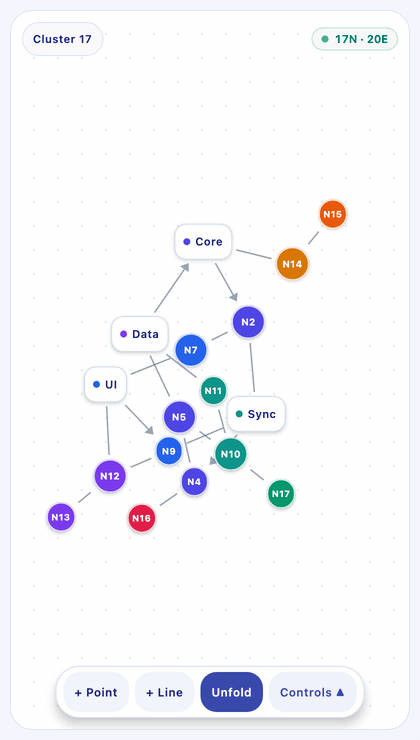
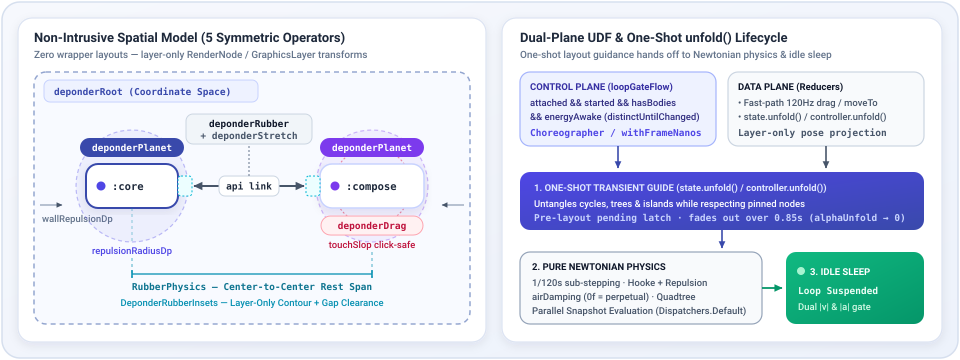

# Deponder

[](https://search.maven.org/search?q=g:%22io.github.cinpecan%22%20AND%20a:%22deponder%22)

<p align="start">
  <a href="README_zh.md"><b>中文说明</b></a>
</p>

Deponder is a force-directed physics interaction library for **Compose Multiplatform** (Android, iOS, Desktop, Web/Wasm), **SwiftUI** (iOS 18+, macOS 15+ via Swift Package Manager + official Kotlin Swift Export), and **Android Views**. Attach physical bodies, spring links, and click-safe dragging directly to standard UI components via `Modifier`s, SwiftUI `View` modifiers, or `View` extensions—updating render transforms without wrapper layouts or per-frame relayout.

<p align="center">
  
</p>

## Architecture & Operators

<p align="center">
  
</p>

All UI toolkits share the same five-operator model backed by a single UI-agnostic `deponder-core` kernel — invoked as `Modifier.deponder*` in Compose, `View.deponder*` in SwiftUI, and `View` / `ViewGroup.deponder*` in Android Views:

| Operator | Attach To | Role |
| :--- | :--- | :--- |
| `deponderRoot` | Container (`Box`, `ZStack`, `ViewGroup`) | Simulation coordinate space and frame loop |
| `deponderPlanet` | Node component | Point-mass body with repulsion range and pinning |
| `deponderRubber` | Link component | Hooke spring link with endpoint safe-area trimming |
| `deponderStretch` | Link or inner line child | Stretches a custom link or inner child along the span |
| `deponderDrag` | Node or drag handle | Pointer dragging with `touchSlop` click preservation |

- **Hierarchy rules**: In Compose and SwiftUI, `deponderPlanet` and `deponderRubber` can live at any static nesting depth inside `deponderRoot` (and in SwiftUI, `.deponderDrag()` works both outside `.deponderPlanet()` and on inner child handles). In Compose, use `EdgeKey(a, b)` as a symmetric, collision-free `key(...)` for undirected links. In Android Views, `deponderPlanet` and `deponderRubber` views must be **direct children** of the `deponderRoot` `ViewGroup` (bindings store private keyed tag IDs and never alter `View.getTag()`, child order, or `clipChildren`).
- **Gesture coexistence**: `deponderDrag` defers interception until pointer movement exceeds `touchSlop`, keeping `.clickable {}`, SwiftUI `Button` / `.onTapGesture`, `OnClickListener`, `OnLongClickListener`, and touch ripples intact. It can be attached to the planet component itself or to an inner drag-handle child.
- **Frame scheduling & sleep**: Simulation steps use `1/120s` adaptive sub-stepping for consistent motion across 60Hz–240Hz displays and suspend display-link / VSYNC frame callbacks (`isAwake == false`) once free-body velocities and accelerations settle below rest thresholds. Any state mutation or touch interaction resumes the loop on demand.

## Installation

### Gradle / Maven Central

| Artifact | Target | Platforms |
| :--- | :--- | :--- |
| `deponder-compose` | Compose Multiplatform & Jetpack Compose | Android, iOS, Desktop (JVM 17), Web (`wasmJs`) |
| `deponder` | Android `View` / `ViewGroup` | Android (`minSdk 23`, JVM 17) |
| `deponder-core` | Headless simulation / custom `Canvas` | Android, iOS, macOS (`macosArm64`), Desktop (JVM 17), Web (`wasmJs`) |
| `deponder-bom` | Maven BOM for version alignment | All |

All Maven artifacts are published under `io.github.cinpecan`. `deponder-compose` depends only on `compose-runtime` and `compose-ui` (no `compose-foundation` or Material); `deponder` depends only on `lifecycle-common`.

**Compose Multiplatform (`commonMain`) or Jetpack Compose:**

```kotlin
dependencies {
    implementation("io.github.cinpecan:deponder-compose:0.7.0")
}
```

**Android View:**

```kotlin
dependencies {
    implementation("io.github.cinpecan:deponder:0.7.0")
}
```

**Hybrid Android View + Compose (with BOM):**

```kotlin
dependencies {
    implementation(platform("io.github.cinpecan:deponder-bom:0.7.0"))
    implementation("io.github.cinpecan:deponder")
    implementation("io.github.cinpecan:deponder-compose")
}
```

### Swift Package Manager (Native iOS 18+ / macOS 15+)

Add `https://github.com/cinpeCan/Deponder.git` (`0.7.0`+) in Xcode (**File → Add Package Dependencies…**) or `Package.swift` — zero Kotlin/Gradle toolchain or Objective-C bridging required:

| Product | Target | Platforms |
| :--- | :--- | :--- |
| `Deponder` | Native SwiftUI operators + `DeponderDefaultRubber` (re-exports `DeponderCore`) | iOS 18+, macOS 15+ (`arm64`) |
| `DeponderCore` | Headless Swift Export physics kernel (`SimulationWorld`, configs, presets) | iOS 18+, macOS 15+ (`arm64`) |

```swift
dependencies: [
    .package(url: "https://github.com/cinpeCan/Deponder.git", from: "0.7.0")
]
```

## Quick Start: Compose Multiplatform

Mount `Modifier.deponderRoot` on an unconstrained container such as `Box`:

```kotlin
val state = rememberDeponderState(
    RootPhysics.fromPreset(DeponderDefaults.Presets.Balanced)
)

// Optional: untangle cycles, trees, or disconnected islands on load or topology change
LaunchedEffect(links) {
    state.unfold()
}

Box(modifier = Modifier.fillMaxSize().deponderRoot(state)) {
    links.forEach { link ->
        key(EdgeKey(link.fromId, link.toId)) {
            DeponderDefaultRubber(
                startId = link.fromId,
                endId = link.toId,
                label = link.relation,
                arrowMode = DeponderArrowMode.END,
                physics = RubberPhysics(),
                insets = DeponderRubberInsets.Default,
            )
        }
    }

    nodes.forEach { node ->
        NodeCard(
            node = node,
            modifier = Modifier
                .align(Alignment.Center)
                .deponderPlanet(
                    id = node.id,
                    physics = PlanetPhysics(repulsionRadiusDp = 80f, pinned = node.isAnchor),
                )
                .deponderDrag()
                .clickable { onNodeClicked(node) },
        )
    }
}
```

## Quick Start: Android View (Kotlin, XML & Java)

Mount `deponderRoot` on a container such as `FrameLayout`, `ConstraintLayout`, or `CoordinatorLayout` with planet and rubber views added as **direct children**:

```kotlin
val controller = rootFrameLayout.deponderRoot(
    lifecycleOwner = this,
    physics = RootPhysics.fromPreset(DeponderDefaults.Presets.Balanced),
)

val rubberView = DeponderRubberView(this)
    .withLabel("depends on")
    .withArrowMode(DeponderArrowMode.END)
rootFrameLayout.addView(rubberView)
rubberView.deponderRubber("core", "ui")

cardCore.deponderPlanet("core", PlanetPhysics(pinned = true))
cardUi.deponderPlanet("ui")
cardUi.deponderDrag()
cardUi.setOnClickListener { showDetail("ui") }

// Safe to call before the first layout pass completes
controller.unfold()

// Unbind dynamically removed views when needed
// cardUi.clearDeponderPlanet()
// rubberView.clearDeponderRubber()
```

`DeponderRubberView` also supports XML inflation and binds automatically on attach when both `app:deponderStartId` and `app:deponderEndId` are provided:

```xml
<com.cinpe.deponder.DeponderRubberView
    android:layout_width="wrap_content"
    android:layout_height="wrap_content"
    app:deponderStartId="core"
    app:deponderEndId="ui"
    app:deponderLabel="depends on"
    app:deponderArrowMode="end"
    app:deponderNaturalLength="wrap_content"
    app:deponderInsets="both" />
```

Java callers can use static methods on `DeponderViews` (`deponderRoot`, `deponderPlanet`, `deponderRubber`, `deponderStretch`, `deponderDrag`, `clearDeponderPlanet`, `clearDeponderRubber`) alongside fluent `with*` builders on `DeponderRubberView`.

## Quick Start: SwiftUI (iOS 18+ / macOS 15+)

Mount `.deponderRoot(state)` on an unconstrained container such as `ZStack`:

```swift
import Deponder
import SwiftUI

struct KnowledgeGraphView: View {
    @State private var state = DeponderState(physics: .balanced)

    var body: some View {
        ZStack {
            ForEach(links) { link in
                DeponderDefaultRubber(
                    startId: link.fromId,
                    endId: link.toId,
                    label: link.relation,
                    arrowMode: .end,
                    physics: .default,
                    insets: .default
                )
            }

            ForEach(nodes) { node in
                NodeCard(node: node)
                    .deponderPlanet(
                        id: node.id,
                        physics: .make(repulsionRadiusDp: 80, pinned: node.isAnchor)
                    )
                    .deponderDrag()
                    .onTapGesture { select(node) }
            }
        }
        .frame(maxWidth: .infinity, maxHeight: .infinity)
        .deponderRoot(state)
        .onAppear { state.unfold() }
    }
}
```

## Physics Configuration & Presets

### Built-in Presets

`DeponderDefaults.Presets` provides three ready-to-use configurations:

| Preset | Damping | Wall / Node Range | Spring | Characteristics |
| :--- | :--- | :--- | :--- | :--- |
| `Balanced` | `1.45f` | `110dp` / `80dp` | `1.68f` | General-purpose damping with one mild rebound |
| `Crisp` | `2.6f` | `110dp` / `80dp` | `2.4f` | Higher damping and stiffer springs for fast settling |
| `GalaxyInfinite` | `1.6f` | `INFINITE_RANGE` | `1.5f` | Full-viewport centering and `1/r²` repulsion |

Apply a preset consistently across all three config objects:

```kotlin
val preset = DeponderDefaults.Presets.Balanced
val rootPhysics = RootPhysics.fromPreset(preset)
val planetPhysics = PlanetPhysics.fromPreset(preset, pinned = false)
val rubberPhysics = RubberPhysics.fromPreset(preset)
```

### Configuration Types

- **`RootPhysics`**:
  - `airDamping` (`1/s`): Newtonian viscous drag controlling velocity decay. Set to `0f` for undamped perpetual motion.
  - `initScale`, `minScale`, `maxScale`: Zoom multiplier bounds (`1.0f`, `0.5f`, `1.5f` by default).
  - `wallRepulsionDp`: Distance in `dp` from container edges where inward wall forces act. Pass `DeponderDefaults.INFINITE_RANGE` (`-1f`) for full-viewport centering forces; customize per-edge stiffness with `wallElasticityStart/Top/End/Bottom`.
  - Builders: `withAirDamping(...)`, `withScaleBounds(initScale, minScale, maxScale)`, `withWallRepulsionDp(...)`.
- **`PlanetPhysics`**:
  - `mass` (`2.293f`): Point-mass inertia.
  - `repulsionRadiusDp` (`80f`): Finite interaction radius in `dp`, or `DeponderDefaults.INFINITE_RANGE` (`-1f`) for an unbounded `1/r²` electrostatic field. Repulsion honors this explicit value directly without implicit degree scaling.
  - `elasticity` (`1.33f`): Positive values repel nearby planets; negative values attract.
  - `pinned` (`false`): Fixes a planet at its current position while still exerting forces on neighbors.
  - Builders: `withMass(...)`, `withRepulsionRadiusDp(...)`, `withElasticity(...)`, `withPinned(...)`.
- **`RubberPhysics`**:
  - **Content-adaptive (default)**: `RubberPhysics()` (`DeponderDefaults.AUTO_LENGTH`) expands rest length from the measured label width plus padding:
    `RubberPhysics.auto(contentPaddingDp = 80f, minLengthDp = 110f, maxLengthDp = DeponderDefaults.INFINITE_RANGE, elasticity = 1.68f)`
  - **Fixed length**: `RubberPhysics.fixed(naturalLengthDp = 120f, elasticity = 1.68f)` or `RubberPhysics(elasticity = 1.68f, naturalLengthDp = 120f)`.
  - Builders: `withElasticity(...)`, `withNaturalLengthDp(...)`, `withAutoLength(...)`.

## Link Geometry & Custom Links

### Center-to-Center Span vs. Endpoint Safe Area

Deponder separates physical equilibrium in `deponder-core` from endpoint visual trimming in the UI layer:

- **`RubberPhysics` sets center-to-center rest length**: Planets are point masses whose dimensions are independent of spring forces. Both `naturalLengthDp` and `RubberPhysics.auto(...)` constrain the distance between the **centers** of `startId` and `endId`.
- **`DeponderRubberInsets` trims only the visual span**: During layout projection and rendering, endpoint insets are subtracted along the link axis without changing spring forces or triggering relayout:

  ```text
  visibleSpanPx = max(0f, centerDistancePx - startInsetPx - endInsetPx)
  ```

- **Sizing links between wide cards**: When nodes are wide pills or cards rather than small circles, ensure the spring rest length and repulsion range exceed the combined node half-widths:

  ```text
  naturalLengthDp >= halfWidth(start) + halfWidth(end) + desiredGapDp
  ```

  Otherwise springs will pull wide cards into overlap or reduce `visibleSpanPx` to `0px`.

### `DeponderRubberInsets` Modes

| Preset / Factory | Start → End | Behavior |
| :--- | :--- | :--- |
| `Default` / `contour(gapDp)` | `CONTOUR` → `CONTOUR` | Trims at rounded-box contours plus `gapDp` (`4dp` default; also `contour(startDp, endDp)`) |
| `None` / `none()` | `NONE` → `NONE` | Connects center-to-center; omits built-in arrowheads on `NONE` endpoints |
| `fixed(insetDp)` | `FIXED` → `FIXED` | Trims by explicit `dp` distances from each planet center (also `fixed(startDp, endDp)`) |
| `startOnly(gapDp)` | `CONTOUR` → `NONE` | Trims at `startId` contour and anchors to `endId` center |
| `endOnly(gapDp)` | `NONE` → `CONTOUR` | Anchors to `startId` center and stops arrowheads at `endId` contour |

Use per-side builders (`withStartNone()`, `withEndNone()`, `withStartContour(gapDp)`, `withEndContour(gapDp)`, `withStartFixed(insetDp)`, `withEndFixed(insetDp)`) to mix modes independently.

### Styling Built-in Links

- **Arrowheads (`DeponderArrowMode`)**: `NONE`, `END`, `START`, `BOTH`.
- **Compose (`DeponderRubberStyle`)**: customize `DeponderDefaultRubber` colors, line thickness, arrow size, and label styling via `DeponderRubberStyle.of(lineColor, lineThickness, arrowSize, labelColor, labelTextSize, labelBackgroundColor)`.
- **SwiftUI (`DeponderRubberStyle`)**: customize `DeponderDefaultRubber` via `DeponderRubberStyle(lineColor:lineThickness:arrowSize:labelColor:labelTextSize:labelBackgroundColor:)`.
- **Android View (`DeponderRubberView`)**: configure programmatically with `withLabel`, `withArrowMode`, `withInsets`, `withPhysics`, `withLineStyle`, `withLabelStyle`, or in XML with `app:deponderStartId`, `app:deponderEndId`, `app:deponderElasticity`, `app:deponderNaturalLength` (`wrap_content` or dimension), `app:deponderInsets` (`both`, `none`, `start`, `end`, or dimension), `app:deponderInsetGap`, `app:deponderLabel`, `app:deponderArrowMode` (`none`, `end`, `start`, `both`), `app:deponderLineColor`, `app:deponderLineThickness`, `app:deponderArrowSize`, `app:deponderLabelColor`, `app:deponderLabelTextSize`, and `app:deponderLabelBackgroundColor`.

### Custom Link Layouts

Combine `deponderRubber` with `deponderStretch` to render any custom Composable, SwiftUI `View`, or Android `View` as a spring link. Placing `deponderStretch` on an inner line view/composable stretches only that child while keeping sibling badges or labels at their unstretched size:

- **Compose**: chain `Modifier.deponderRubber(startId, endId, physics, insets)` on the link container and `Modifier.deponderStretch()` on the line element (or directly on the root link modifier).
- **SwiftUI**: attach `.deponderRubber(startId:endId:physics:insets:)` to the link container and `.deponderStretch()` to the line child (or directly upstream on a single line view).
- **Android View**: call `linkContainer.deponderRubber(startId, endId, physics, insets)` and mark the stretching child with `lineView.deponderStretch()` or XML `android:tag="@string/deponder_stretch"`.

## Runtime Control & Headless `SimulationWorld`

### `DeponderState` (Compose / SwiftUI) & `DeponderController` (Android View)

All three hosts expose a unified runtime control surface:

- **Layout & global physics**: `unfold()`, `updatePhysics(newPhysics)`, `submitScale(scale)`, `submitRubberElasticity(elasticity)`, `setPinned(id, pinned)`
- **Imperative node control**: `moveTo(id, xPx, yPx)`, `dragBy(id, dxPx, dyPx)`, `setPressed(id, pressed)`, `bringToFront(id)`
- **Observed state**: `scale`, `isAwake`, `physics` (plus `cancel()`, `isCancelled`, and `rootView` on `DeponderController`)

`unfold()` runs a single topological untangling pass across cycles, trees, and disconnected components while respecting pinned or actively dragged nodes, then transitions smoothly into normal spring dynamics. Calling it before the first layout pass defers execution until node positions and viewport bounds are ready.

### Using `deponder-core` Headlessly (`SimulationWorld`)

Use `SimulationWorld` directly on custom canvases, desktop simulations, or non-UI targets:

```kotlin
val world = SimulationWorld(RootPhysics().toEnvironmentSpec(density))
world.updateViewport(widthPx, heightPx)

world.syncTopology(
    planets = listOf(PlanetPhysics().toPlanetSpec("a", density), PlanetPhysics().toPlanetSpec("b", density)),
    edges = listOf(RubberPhysics().toRubberSpec("a", "b", density)),
    initialPositionProvider = { Vec2(widthPx * 0.5f, heightPx * 0.5f) },
)
// Or register incrementally via upsertPlanet / upsertRubber and removePlanet / removeRubber

world.unfold()

// In your render loop (dtSeconds from frame clock):
val keepStepping = world.step(dtSeconds, scale)
val body = world.bodies.first()           // x, y, vx, vy, dx, dy
val pose = world.rubbers.first()          // centerX, centerY, rotationDeg
val visiblePx = pose.resolvedLength(DeponderRubberInsets.Default, density)
```

## License

Licensed under the Apache License, Version 2.0. See [LICENSE](LICENSE).

```text
Copyright (c) 2022-present, Cinpecan and Deponder Contributors.
Licensed under the Apache License, Version 2.0: https://www.apache.org/licenses/LICENSE-2.0
```
