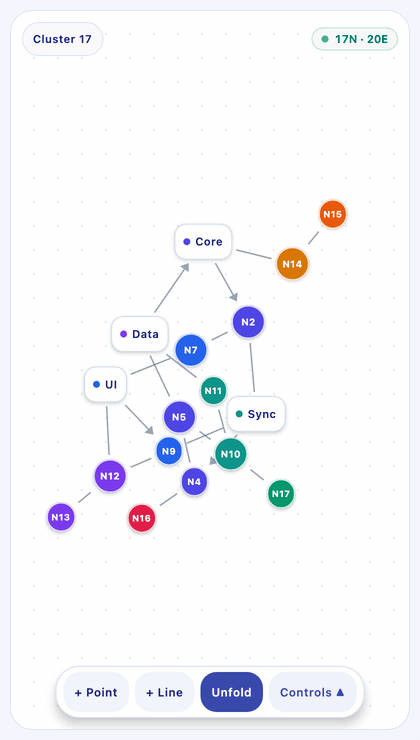
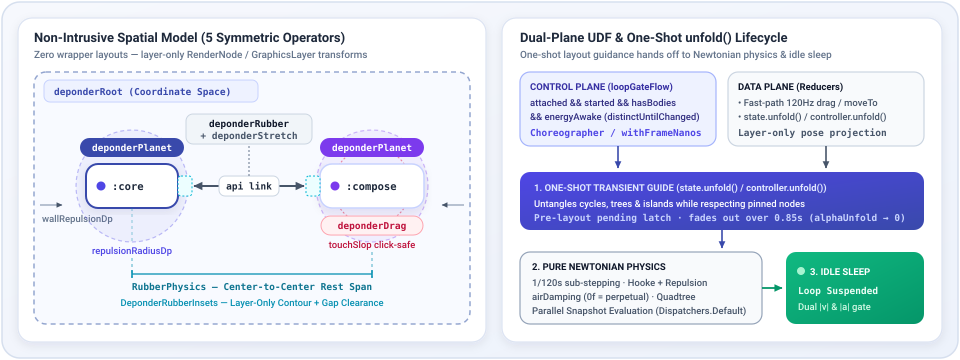

# Deponder

[](https://search.maven.org/search?q=g:%22io.github.cinpecan%22%20AND%20a:%22deponder%22)

<p align="start">
  <a href="README.md"><b>English</b></a>
</p>

Deponder 是面向 **Compose Multiplatform**（Android / iOS / Desktop / Web Wasm）、**SwiftUI**（iOS 18+ / macOS 15+，基于官方 Kotlin Swift Export 与 Swift Package Manager）与 **Android 原生 View** 的力导向物理交互库。通过 `Modifier`、SwiftUI `View` 修饰符与 `View` 扩展，直接为现有 UI 组件附加质点排斥、弹簧牵引与物理拖拽交互，在渲染变换层更新位移与形变，无需引入额外包裹容器或每帧重排视图树。

<p align="center">
  
</p>

## 架构与接入能力

<p align="center">
  
</p>

Compose、SwiftUI 与 Android View 三端基于同一套无 UI 依赖的 `deponder-core` 物理内核，共享一致的 5 算子模型（分别以 `Modifier.deponder*`、SwiftUI `View.deponder*` 与 Android `View` / `ViewGroup.deponder*` 形式挂载）：

| 算子 | 挂载目标 | 作用 |
| :--- | :--- | :--- |
| `deponderRoot` | 根容器（`Box` / `ZStack` / `ViewGroup`） | 建立仿真坐标系并驱动帧循环 |
| `deponderPlanet` | 节点组件 | 注册具备质量、斥力半径与固定状态的质点 |
| `deponderRubber` | 连线组件 | 连接两端节点 ID，建立弹簧力与端点安全区裁剪 |
| `deponderStretch` | 连线或内部线条子元素 | 使自定义连线或内部线条随间距拉伸 |
| `deponderDrag` | 节点本体或拖拽手柄 | 启用物理拖拽，并通过 `touchSlop` 保留点击事件 |

- **视图层级约定**：在 Compose 与 SwiftUI 中，`deponderPlanet` 与 `deponderRubber` 可放置于 `deponderRoot` 内部任意静态嵌套深度（SwiftUI 下 `.deponderDrag()` 同时兼容挂在 `.deponderPlanet()` 外侧或内部手柄子视图上）；Compose 无向连线建议使用对称且无冲突的 `EdgeKey(a, b)` 作为 `key(...)`。在 Android View 中，`deponderPlanet` 与 `deponderRubber` 必须是 `deponderRoot` 容器的**直接子 View**；绑定信息保存在私有资源 tag ID 中，不覆盖业务方 `View.getTag()`、子视图顺序或宿主 `clipChildren` 设置。
- **手势共存**：`deponderDrag` 在手指位移超过 `touchSlop` 后才接管事件，保持原有的 `.clickable {}`、SwiftUI `Button` / `.onTapGesture`、`OnClickListener`、`OnLongClickListener` 与点击水波纹反馈正常工作；拖拽修饰符既可直接加在节点本体，也可加在节点内部的指定手柄区域。
- **帧调度与静止休眠**：内核使用自适应 `1/120s` 子步积分，在不同刷新率（60Hz–240Hz）屏幕上保持一致的运动速度；当自由节点的速率与加速度同时低于休眠阈值并持续稳定后，帧循环会自动挂起 DisplayLink / VSYNC 回调（`isAwake == false`），CPU 占用归零，待下次状态变更或触摸交互时即时恢复。

## 依赖引入

### Gradle / Maven Central

| Maven 构件 | 适用场景 | 支持平台 |
| :--- | :--- | :--- |
| `deponder-compose` | Compose Multiplatform 与 Jetpack Compose | Android、iOS、Desktop (JVM 17)、Web (`wasmJs`) |
| `deponder` | Android 原生 `View` / `ViewGroup` | Android（`minSdk 23`, JVM 17） |
| `deponder-core` | 无 UI 物理仿真或自绘 `Canvas` | Android、iOS、macOS (`macosArm64`)、Desktop (JVM 17)、Web (`wasmJs`) |
| `deponder-bom` | 跨模块版本对齐 BOM | 全平台 |

所有构件均发布在 `io.github.cinpecan` 下。`deponder-compose` 仅依赖 `compose-runtime` 与 `compose-ui`（不引入 `compose-foundation` 或 Material）；`deponder` 仅依赖 `lifecycle-common`。

**Compose Multiplatform（`commonMain`）或 Jetpack Compose：**

```kotlin
dependencies {
    implementation("io.github.cinpecan:deponder-compose:0.7.0")
}
```

**Android View：**

```kotlin
dependencies {
    implementation("io.github.cinpecan:deponder:0.7.0")
}
```

**Android View + Compose 混合工程（通过 BOM 对齐版本）：**

```kotlin
dependencies {
    implementation(platform("io.github.cinpecan:deponder-bom:0.7.0"))
    implementation("io.github.cinpecan:deponder")
    implementation("io.github.cinpecan:deponder-compose")
}
```

### Swift Package Manager（原生 iOS 18+ / macOS 15+）

直接在 Xcode（**File → Add Package Dependencies…**）或 `Package.swift` 中引入 `https://github.com/cinpeCan/Deponder.git`（`0.7.0`+），无需任何 Kotlin / Gradle 工具链或 Objective-C 桥接：

| Product | 目标平台与定位 | 系统/架构要求 |
| :--- | :--- | :--- |
| `Deponder` | 原生 SwiftUI 五大算子与 `DeponderDefaultRubber`（自动导出 `DeponderCore`） | iOS 18+、macOS 15+（`arm64`） |
| `DeponderCore` | 官方 Kotlin Swift Export 导出的无 UI 物理内核（`SimulationWorld`、配置与预设） | iOS 18+、macOS 15+（`arm64`） |

```swift
dependencies: [
    .package(url: "https://github.com/cinpeCan/Deponder.git", from: "0.7.0")
]
```

## 快速上手：Compose Multiplatform

将 `Modifier.deponderRoot` 挂载在 `Box` 等无强排布约束的容器上：

```kotlin
val state = rememberDeponderState(
    RootPhysics.fromPreset(DeponderDefaults.Presets.Balanced)
)

// 可选：在首次加载或拓扑变更时触发一次理顺展开
LaunchedEffect(links) {
    state.unfold()
}

Box(modifier = Modifier.fillMaxSize().deponderRoot(state)) {
    links.forEach { link ->
        key(EdgeKey(link.fromId, link.toId)) {
            DeponderDefaultRubber(
                startId = link.fromId,
                endId = link.toId,
                label = link.relation,
                arrowMode = DeponderArrowMode.END,
                physics = RubberPhysics(),
                insets = DeponderRubberInsets.Default,
            )
        }
    }

    nodes.forEach { node ->
        NodeCard(
            node = node,
            modifier = Modifier
                .align(Alignment.Center)
                .deponderPlanet(
                    id = node.id,
                    physics = PlanetPhysics(repulsionRadiusDp = 80f, pinned = node.isAnchor),
                )
                .deponderDrag()
                .clickable { onNodeClicked(node) },
        )
    }
}
```

## 快速上手：Android View（Kotlin、XML 与 Java）

将 `deponderRoot` 挂载在 `FrameLayout`、`ConstraintLayout` 或 `CoordinatorLayout` 等容器上，并将节点与连线作为其**直接子 View** 添加：

```kotlin
val controller = rootFrameLayout.deponderRoot(
    lifecycleOwner = this,
    physics = RootPhysics.fromPreset(DeponderDefaults.Presets.Balanced),
)

val rubberView = DeponderRubberView(this)
    .withLabel("依赖")
    .withArrowMode(DeponderArrowMode.END)
rootFrameLayout.addView(rubberView)
rubberView.deponderRubber("core", "ui")

cardCore.deponderPlanet("core", PlanetPhysics(pinned = true))
cardUi.deponderPlanet("ui")
cardUi.deponderDrag()
cardUi.setOnClickListener { showDetail("ui") }

// 支持在首次布局完成前调用
controller.unfold()

// 动态移除组件时可显式解绑
// cardUi.clearDeponderPlanet()
// rubberView.clearDeponderRubber()
```

`DeponderRubberView` 也支持直接在 XML 布局中声明，若同时指定了 `app:deponderStartId` 与 `app:deponderEndId`，会在视图附加到窗口时自动绑定两端节点：

```xml
<com.cinpe.deponder.DeponderRubberView
    android:layout_width="wrap_content"
    android:layout_height="wrap_content"
    app:deponderStartId="core"
    app:deponderEndId="ui"
    app:deponderLabel="依赖"
    app:deponderArrowMode="end"
    app:deponderNaturalLength="wrap_content"
    app:deponderInsets="both" />
```

Java 调用方可通过 `DeponderViews` 静态方法（`deponderRoot`、`deponderPlanet`、`deponderRubber`、`deponderStretch`、`deponderDrag`、`clearDeponderPlanet`、`clearDeponderRubber`）以及 `DeponderRubberView` 的流式 `with*` 方法链式配置。

## 快速上手：SwiftUI（iOS 18+ / macOS 15+）

将 `.deponderRoot(state)` 挂载在 `ZStack` 等容器上：

```swift
import Deponder
import SwiftUI

struct KnowledgeGraphView: View {
    @State private var state = DeponderState(physics: .balanced)

    var body: some View {
        ZStack {
            ForEach(links) { link in
                DeponderDefaultRubber(
                    startId: link.fromId,
                    endId: link.toId,
                    label: link.relation,
                    arrowMode: .end,
                    physics: .default,
                    insets: .default
                )
            }

            ForEach(nodes) { node in
                NodeCard(node: node)
                    .deponderPlanet(
                        id: node.id,
                        physics: .make(repulsionRadiusDp: 80, pinned: node.isAnchor)
                    )
                    .deponderDrag()
                    .onTapGesture { select(node) }
            }
        }
        .frame(maxWidth: .infinity, maxHeight: .infinity)
        .deponderRoot(state)
        .onAppear { state.unfold() }
    }
}
```

## 物理参数与预设

### 内置预设

`DeponderDefaults.Presets` 提供三组常用参数预设：

| 预设 | 阻尼 | 边界 / 节点范围 | 弹簧刚度 | 适用特征 |
| :--- | :--- | :--- | :--- | :--- |
| `Balanced` | `1.45f` | `110dp` / `80dp` | `1.68f` | 通用均衡阻尼，一次轻度回弹后稳定 |
| `Crisp` | `2.6f` | `110dp` / `80dp` | `2.4f` | 更高阻尼与弹簧刚度，快速收敛 |
| `GalaxyInfinite` | `1.6f` | `INFINITE_RANGE` | `1.5f` | 全视口居中边界力与全局 `1/r²` 斥力 |

```kotlin
val preset = DeponderDefaults.Presets.Balanced
val rootPhysics = RootPhysics.fromPreset(preset)
val planetPhysics = PlanetPhysics.fromPreset(preset, pinned = false)
val rubberPhysics = RubberPhysics.fromPreset(preset)
```

### 配置项说明

- **`RootPhysics`**：
  - `airDamping`（`1/s`）：牛顿粘滞空气阻力系数，控制速度衰减快慢；设为 `0f` 时无阻尼持续运动。
  - `initScale`、`minScale`、`maxScale`：全局缩放倍率及边界约束（默认 `1.0f` / `0.5f` / `1.5f`）。
  - `wallRepulsionDp`：容器边缘内推缓冲区宽度（单位 `dp`）；传入 `DeponderDefaults.INFINITE_RANGE`（`-1f`）可启用全视口居中收敛力，四边刚度可通过 `wallElasticityStart/Top/End/Bottom` 分别调节。
  - 衍生拷贝：`withAirDamping(...)`、`withScaleBounds(initScale, minScale, maxScale)`、`withWallRepulsionDp(...)`。
- **`PlanetPhysics`**：
  - `mass`（`2.293f`）：质点惯性质量。
  - `repulsionRadiusDp`（`80f`）：节点斥力生效半径（单位 `dp`），设为 `DeponderDefaults.INFINITE_RANGE`（`-1f`）时切换为无边界平方反比力场；斥力范围严格按该显式参数生效，不会随连线数量自动膨胀。
  - `elasticity`（`1.33f`）：力场刚度，正值相斥、负值相吸。
  - `pinned`（`false`）：将节点固定在当前位置，同时继续参与对邻近节点的作用力计算。
  - 衍生拷贝：`withMass(...)`、`withRepulsionRadiusDp(...)`、`withElasticity(...)`、`withPinned(...)`。
- **`RubberPhysics`**：
  - **内容自适应（默认）**：`RubberPhysics()`（`DeponderDefaults.AUTO_LENGTH`）会根据连线标签测量宽度动态计算静息长度：
    `RubberPhysics.auto(contentPaddingDp = 80f, minLengthDp = 110f, maxLengthDp = DeponderDefaults.INFINITE_RANGE, elasticity = 1.68f)`
  - **固定长度**：`RubberPhysics.fixed(naturalLengthDp = 120f, elasticity = 1.68f)` 或 `RubberPhysics(elasticity = 1.68f, naturalLengthDp = 120f)`。
  - 衍生拷贝：`withElasticity(...)`、`withNaturalLengthDp(...)`、`withAutoLength(...)`。

## 连线几何与自定义连线

### 物理静息长度与端点安全区

Deponder 将物理内核的力学平衡与 UI 渲染层的视觉裁剪正交拆分：

- **`RubberPhysics` 约束两端节点中心的物理间距**：`deponder-core` 中的每个节点都是纯质点，不受卡片自身宽高影响。`naturalLengthDp` 与 `RubberPhysics.auto(...)` 决定的都是 `startId` 与 `endId` **中心点之间**的弹簧平衡距离。
- **`DeponderRubberInsets` 仅在渲染层裁切视觉端点**：计算连线显示长度与居中偏移时，渲染层仅沿连线方向扣减安全区距离，既不改变物理受力，也不会引发容器重排：

  ```text
  visibleSpanPx = max(0f, centerDistancePx - startInsetPx - endInsetPx)
  ```

- **宽卡片与胶囊节点的长度预算**：当节点渲染为宽文字胶囊或卡片而非小圆点时，建议同时为弹簧自然长度和核心节点斥力半径留出卡片半宽预算：

  ```text
  naturalLengthDp >= halfWidth(start) + halfWidth(end) + desiredGapDp
  ```

  并同步调大对应节点的 `PlanetPhysics(repulsionRadiusDp = ...)`，避免弹簧将较宽卡片拉至重叠，或因扣减安全区后使 `visibleSpanPx` 归零。

### `DeponderRubberInsets` 安全区模式

| 预设 / 工厂方法 | 起点 → 终点 | 行为说明 |
| :--- | :--- | :--- |
| `Default` / `contour(gapDp)` | `CONTOUR` → `CONTOUR` | 沿圆角矩形轮廓裁切并外扩 `gapDp`（默认 `4dp`，亦支持 `contour(startDp, endDp)`） |
| `None` / `none()` | `NONE` → `NONE` | 直接连接两端节点中心；内置连线在 `NONE` 端不绘制箭头 |
| `fixed(insetDp)` | `FIXED` → `FIXED` | 按距节点中心的固定 `dp` 距离裁切（亦支持 `fixed(startDp, endDp)`） |
| `startOnly(gapDp)` | `CONTOUR` → `NONE` | 起点在轮廓外缘断开，终点直连节点中心 |
| `endOnly(gapDp)` | `NONE` → `CONTOUR` | 起点直连中心，终点箭头停在目标节点轮廓边缘 |

需要混合不同端点的模式时，可使用 `withStartNone()`、`withEndNone()`、`withStartContour(gapDp)`、`withEndContour(gapDp)`、`withStartFixed(insetDp)` 与 `withEndFixed(insetDp)` 单独调整。

### 内置连线样式与 XML 属性

- **箭头模式（`DeponderArrowMode`）**：`NONE`、`END`、`START`、`BOTH`。
- **Compose（`DeponderRubberStyle`）**：通过 `DeponderRubberStyle.of(lineColor, lineThickness, arrowSize, labelColor, labelTextSize, labelBackgroundColor)` 定制 `DeponderDefaultRubber` 的线条、箭头与标签样式。
- **SwiftUI（`DeponderRubberStyle`）**：通过 `DeponderRubberStyle(lineColor:lineThickness:arrowSize:labelColor:labelTextSize:labelBackgroundColor:)` 定制样式。
- **Android View（`DeponderRubberView`）**：代码层可通过 `withLabel`、`withArrowMode`、`withInsets`、`withPhysics`、`withLineStyle` 与 `withLabelStyle` 配置；XML 支持 `app:deponderStartId`、`app:deponderEndId`、`app:deponderElasticity`、`app:deponderNaturalLength`（`wrap_content` 或具体尺寸）、`app:deponderInsets`（`both` / `none` / `start` / `end` 或具体尺寸）、`app:deponderInsetGap`、`app:deponderLabel`、`app:deponderArrowMode`（`none` / `end` / `start` / `both`）、`app:deponderLineColor`、`app:deponderLineThickness`、`app:deponderArrowSize`、`app:deponderLabelColor`、`app:deponderLabelTextSize` 与 `app:deponderLabelBackgroundColor`。

### 自定义连线组件

将 `deponderRubber` 与 `deponderStretch` 组合即可驱动任意自定义连线布局。将 `deponderStretch` 加在内部的线条子元素上时，内核仅沿间距拉伸线条本体，同级文字或徽章子元素保持原始比例居中显示：

- **Compose**：在连线容器挂载 `Modifier.deponderRubber(startId, endId, physics, insets)`，在线条子组件（或容器自身）追加 `Modifier.deponderStretch()`。
- **SwiftUI**：在连线容器挂载 `.deponderRubber(startId:endId:physics:insets:)`，在内部线条子视图（或单一线条视图自身）追加 `.deponderStretch()`。
- **Android View**：在连线父视图调用 `linkContainer.deponderRubber(startId, endId, physics, insets)`，在需要拉伸的线条子 View 上调用 `lineView.deponderStretch()` 或于 XML 设置 `android:tag="@string/deponder_stretch"`。

## 运行时控制与无 UI 内核调用

### `DeponderState`（Compose / SwiftUI）与 `DeponderController`（Android View）

三端控制句柄提供一致的运行时控制接口：

- **展开与全局物理调节**：`unfold()`、`updatePhysics(newPhysics)`、`submitScale(scale)`、`submitRubberElasticity(elasticity)`、`setPinned(id, pinned)`
- **命令式节点控制**：`moveTo(id, xPx, yPx)`、`dragBy(id, dxPx, dyPx)`、`setPressed(id, pressed)`、`bringToFront(id)`
- **状态读取**：`scale`、`isAwake`、`physics`（Android `DeponderController` 额外提供 `cancel()`、`isCancelled` 与 `rootView`）

调用 `unfold()` 会执行一次性的稀疏拓扑理顺（支持含环图、树形及多连通分量，并尊重已固定或拖拽中的节点），完成后平滑过渡回常规弹簧仿真；若在首次布局测量前调用，任务会自动挂起至坐标与视口就绪后执行。

### 直接使用 `deponder-core`（`SimulationWorld`）

在自绘 `Canvas`、服务端模拟或无 UI 目标平台中可直接驱动 `SimulationWorld`：

```kotlin
val world = SimulationWorld(RootPhysics().toEnvironmentSpec(density))
world.updateViewport(widthPx, heightPx)

world.syncTopology(
    planets = listOf(PlanetPhysics().toPlanetSpec("a", density), PlanetPhysics().toPlanetSpec("b", density)),
    edges = listOf(RubberPhysics().toRubberSpec("a", "b", density)),
    initialPositionProvider = { Vec2(widthPx * 0.5f, heightPx * 0.5f) },
)
// 亦可增量管理：upsertPlanet / upsertRubber / removePlanet / removeRubber

world.unfold()

// 在渲染循环中按帧间隔驱动：
val keepStepping = world.step(dtSeconds, scale)
val body = world.bodies.first()           // x, y, vx, vy, dx, dy
val pose = world.rubbers.first()          // centerX, centerY, rotationDeg
val visiblePx = pose.resolvedLength(DeponderRubberInsets.Default, density)
```

## 开源协议

本项目基于 Apache License 2.0 协议开源，完整条款见 [LICENSE](LICENSE)。

```text
Copyright (c) 2022-present, Cinpecan and Deponder Contributors.
Licensed under the Apache License, Version 2.0: https://www.apache.org/licenses/LICENSE-2.0
```
